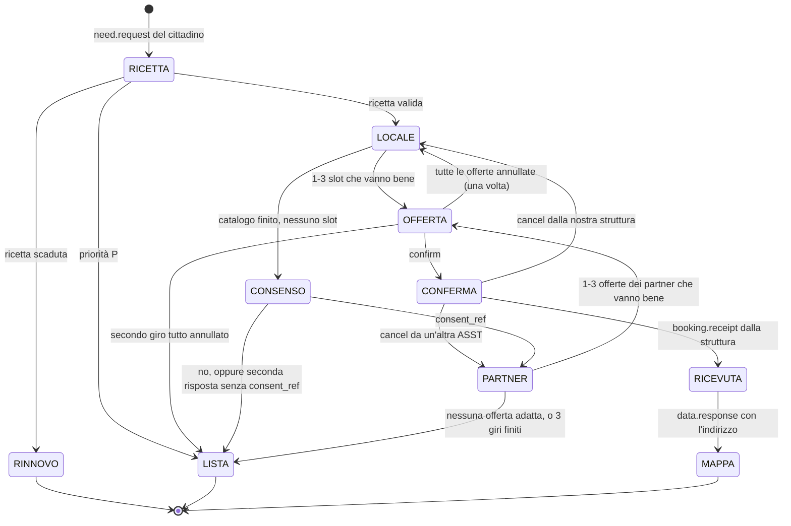

# Centro prenotazioni: la macchina a stati

Questo documento dice **come deve muoversi** il booking (`asst/brain/parts/30_booking.py`).
Ogni patch futura parte da qui: prima si trova lo stato, poi si cambia il codice di quello stato.
Ogni stato ha un test di replay in `asst/tests/test_replay.py`.

Fonte: 67 percorsi letti dalla console il 21/11 tra le 01:18 e le 01:45 (26 nati dopo il deploy di
booking 1.0.10 delle 01:01, 41 nati prima e usati come contesto). Elenco in fondo.

## 1. Fatti della città che comandano il disegno

Questi fatti vengono dal kit (`e19-rules.md`) e dai percorsi veri. Il codice vecchio ne ignorava quattro.

| Fatto | Da dove | Conseguenza |
|---|---|---|
| Un minuto vero è un'ora di agenda (60x). | kit | 16 minuti di silenzio bruciano 16 ore di una finestra B di 48 ore. |
| La finestra della priorità parte **dalla ricetta**, non da adesso. | 0001660002: due offerte rifiutate con `reason=deadline` | Il limite è `emissione + 2 giorni` (B) o `+ 5` (D). |
| Una risposta del Ledger spesso arriva **solo nella history** e non apre un turno. | commento in `00_core.py`, 000180, 000179 | Chi chiede una pagina del catalogo la legge nello stesso turno. |
| Il cittadino sceglie nel turno del **primo** messaggio che nomina un posto. | kit | Un solo messaggio di offerte per volta, massimo 3 righe. |
| Il cittadino annulla **una per una** le offerte fuori dal suo insieme `S`. | 0001420002: 48 annulli | Fuori da `S` non si offre niente: lingua, scadenza, orario passato. |
| Un rifiuto arriva in parole semplici, senza atto e senza il campo chiesto. | kit, 000175 | Dopo la seconda domanda, una risposta senza `consent_ref` è un no. |
| Gli slot locali dentro la finestra finiscono presto (un cittadino al minuto). | `effective_size` 119–152 su 208 | L'altra ASST è il percorso normale dal livello 2, non un'eccezione. |

## 2. Gli stati

Lo stato si ricava dalla history del caso. La memoria del processo (`_SENT`) serve solo per i messaggi
appena mandati che la history non mostra ancora.

Esiti finali: `RICEVUTA` (poi `MAPPA`), `LISTA`, `RINNOVO`. Ogni percorso ne ha **uno solo**.

### RICETTA

| | |
|---|---|
| Riceve | `need.request` con `prescription_number`, `lang`, a volte `days`, `gender`. Prima, dal GP, il `referral` con procedura, priorità e preferenze. |
| Fa | Chiede al Ledger `prescription`, `agenda`, `world page=1`. Se il Ledger tace usa procedura e priorità del referral. |
| Risponde | Niente, se la prima pagina basta. `prescription.wait` se dopo tre attese non c'è ancora la procedura. |
| Si ferma | Ricetta scaduta → `RINNOVO` (`data.request purpose=prescription_renewal`, in italiano o inglese). Stato diverso da `issued` → `prescription.note`. Priorità P → `LISTA`. |

### LOCALE (catalogo della nostra ASST)

| | |
|---|---|
| Riceve | Le pagine `slots page=n/m` del Ledger. |
| Fa | Filtra: medico che parla la lingua, giorno del medico, almeno 4 ore di agenda da adesso, **entro la scadenza contata dalla ricetta**, genere, riserva U. Legge la pagina dopo **nello stesso turno**. |
| Risponde | Una volta "sto controllando", solo se serve la pagina 2. |
| Si ferma | Slot trovati → `OFFERTA`. Pagine finite, pagina 8, oppure (dalla pagina 2) una pagina tutta oltre la scadenza → `CONSENSO`. Nessun nostro medico parla la lingua → `CONSENSO` senza leggere il catalogo. |

### OFFERTA

| | |
|---|---|
| Manda | **Un** messaggio: fino a 3 righe `offer offer_id= slot_id= …` e una frase nella lingua del cittadino. |
| Riceve `confirm` | → `CONFERMA`. |
| Riceve `cancel` | Risponde subito `cancel.ack`. Se il cittadino tiene ancora un'altra offerta, **nient'altro**. Quando non ne tiene più nessuna: un secondo giro (locale o partner), poi `LISTA`. |
| Riceve altro testo | Ripete le offerte una volta, solo se il messaggio è arrivato dopo le offerte. |
| Mai | Un secondo messaggio di offerte mentre il primo è aperto (nemmeno se arriva un'altra pagina del Ledger). |

### CONFERMA

| | |
|---|---|
| Riceve | `confirm offer_id= consent_ref=`. Senza `consent_ref` chiede `consent purpose=booking` una volta. |
| Fa | Manda `confirm` alla struttura, una volta per slot. Verso un'altra ASST aggiunge `cross_asst_consent_ref`. Intanto chiede indirizzo e accessibilità (`data.request purpose=booking`, X-49). |
| Riceve lo stesso `confirm` di nuovo | Risponde `booking.pending`: mai silenzio, mai un secondo confirm alla struttura. |
| Riceve `cancel` dalla struttura | Lo dice al cittadino **con una frase**, poi torna a `LOCALE` o `PARTNER`. Le offerte ancora valide ripartono nel giro nuovo. |
| Riceve `booking.receipt` | → `RICEVUTA`. |

### CONSENSO (regola P2)

| | |
|---|---|
| Manda | `consent purpose=cross_asst` con una domanda semplice. Mai "mi mandi il riferimento": il cittadino rispondeva `Which consent_ref?` o un `data.response` vuoto. |
| Riceve `consent_ref` | → `PARTNER`. |
| Riceve un no | → `LISTA`. |
| Riceve altro senza `consent_ref` | Ripete la domanda **una volta**. Alla seconda risposta senza riferimento → `LISTA`. |
| Mai | Più di due domande (tre se il cittadino rimanda solo la stessa `need.request`). Nessun dato del cittadino esce prima del sì. |

### PARTNER (altre ASST)

| | |
|---|---|
| Fa | `city.find`, poi una `need.request` con soli criteri a ogni struttura (`service_type`, `procedure`, `priority`, `request_id`, `lang`, `gender`, `days`). Aspetta le risposte nello stesso turno. |
| Sceglie | Fra **tutte** le offerte arrivate: medico che parla la lingua (campo `doctor_lang`, altrimenti la tabella dei medici), non nel passato, entro la scadenza della ricetta. Le prime 3 per data, al massimo 2 per struttura. |
| Manda | **Un** messaggio con quelle offerte e `cross_asst=true`. Le altre restano di riserva. |
| Risposta tardiva di un partner | `offer.ack` al partner. Al cittadino niente, se ha già un messaggio di offerte. |
| `cancel offer_id=none` di un partner | `cancel.ack` al partner. Al cittadino niente. |
| Si ferma | Nessuna offerta adatta e tutti hanno risposto → `LISTA`. Dopo 3 messaggi di offerte → `LISTA`. |

### LISTA (esito finale)

`offer offer_id=wl-<need> waiting_list=true procedure= priority=` con una frase. Una volta per need.
Dopo, un `cancel` del cittadino riceve solo `cancel.ack`.

### RICEVUTA e MAPPA

| | |
|---|---|
| Ricevuta | `booking.receipt booking_id= ledger_ref=` + frase + come arrivare + cosa portare. Una per prenotazione. Poi `booking.notice` al nostro GP. |
| Mappa | Alla risposta sull'indirizzo, una sola frase. L'indirizzo è una via senza coordinate: la distanza è **dalla zona** (Municipio) e la frase lo dice. La metro M5 Ca' Granda si nomina solo per le nostre strutture. |

## 3. Dove il codice di oggi non rispetta la macchina

"Oggi" è `main` a booking 1.0.10 (`7ba6207`). Le righe sono di `asst/brain/parts/30_booking.py` su `main`.

| # | Causa vera | Sintomo visto | Percorsi | Riga responsabile | Caso |
|---|---|---|---|---|---|
| 1 | `"wait"` e `"again"` stanno in `sent.offers`. Alla pagina dopo `taken` non è vuoto e il desk crede di avere offerte aperte. | "Sto controllando" e poi silenzio | 000180, 000179, 000187, 0001130004, 0001110004, 0001420003, 0000510005, 0000640006, 0001660002 (16 min) | r. 962 (`sent.offers.add("wait")`) + r. 947 (`if taken and not replacing`) | BK-36 |
| 2 | La pagina dopo si legge solo se il Ledger apre un turno. In `_advance` il giro nello stesso turno c'è solo per `replacement_page`. | Silenzio, come sopra | gli stessi | r. 955–972 e r. 761 | BK-36 |
| 3 | La finestra della priorità è `adesso + giorni`. Deve essere `ricetta + giorni`. `_before_rx_deadline` cerca date che il Ledger non manda. | `cancel … reason=deadline`, raffiche | 0001660002, 0000930002, 0001190002 | `10_shared.py` r. 333 (`horizon = now + …`), r. 265–284 | BK-39 |
| 4 | La domanda di consenso chiede "il riferimento del suo consenso". | `Which consent_ref?`, `data.response purpose=cross_asst` a ripetizione | 000175 (7 volte), 000160 (17 volte), 000172, 000165 | r. 424–427 (`_cross_question`) | BK-40 |
| 5 | `_desk` ripete la domanda a ogni risposta senza riferimento. `_cross_consent` salta `data.response`. | Stesso ciclo | gli stessi | r. 675–677, r. 325 | BK-40 |
| 6 | `_partner_offer` manda il primo gruppo di risposte e controlla la lingua solo se c'è `doctor_lang`. Niente controllo su passato e scadenza, nessun tetto. | Offerte con medico che non parla la lingua, `reason=lang`, `reason=past` | 0001110003, 0001130003, 0000640005, 0000510004, 000141, 0001420002, 000147 | r. 574–614 | BK-38 |
| 7 | `_citizen_cancel` apre una ricerca nuova al primo annullo e manda la lista d'attesa al secondo, anche con un `confirm` in corso. | Lista d'attesa sopra una conferma, raffiche | 0001110003, 000147 | r. 1421–1430 | BK-37 |
| 8 | Dopo il `cancel` di un partner si passa da `_advance` che trova "già chiesto" e si ferma. | Nessun passo dopo `no_capacity` | 0001110003, 000147, 0001160002 | r. 1239 → r. 454–455 (`if sent.cross_sent: return True`) | BK-38 |
| 9 | Un secondo messaggio di offerte mentre il primo è aperto (messaggio del cittadino arrivato prima delle offerte). | Offerte doppie dopo il `confirm` | 000177 | r. 948–953 | BK-37 |
| 10 | `confirm` rimandato: `_on_confirm` esce senza dire niente se il confirm alla struttura è già partito. | Silenzio, `no_reply` | 000147, 0001160002, 0000930002, 0000910002 | r. 1099–1100 | BK-42 |
| 11 | Lingua rara: si leggono 8 pagine anche se nessun nostro medico la parla. | Fino a 80 s di attesa | 0001420003, 000187 | r. 955 | BK-41 |
| 12 | `_route_line` dice "da lei" per una distanza presa dal Municipio e nomina la M5 anche per un'altra ASST. | Mappa uguale per tutti, indicazione sbagliata fuori ASST | 000182, 000185, 000177 | r. 1304–1328, r. 1363 | BK-44 |
| 13 | `_ask_renewal` ha solo la frase italiana. | Lingua sbagliata | (dal codice) | r. 61–66 | BK-43 |

Le cause 1 e 2 insieme spiegano perché il silenzio tornava dopo ogni fix: BK-30 (1.0.10) ha aggiunto
"sto controllando" per coprire l'attesa, e proprio quel messaggio fermava la ricerca alla pagina dopo.

## 4. Cosa resta fuori da questa PR

- **Formato vero del catalogo.** Dalla console non si vedono i messaggi del Ledger. Il simulatore usa
  righe `slot_id= doctor_id= facility= procedure= at= day=` in ordine di data. Se il Ledger ordina in
  un altro modo, la regola "pagina tutta oltre la scadenza → stop" può fermarsi una pagina prima.
  Vale solo dalla pagina 2. Da verificare con `booking.slots` nei log (OPS-07).
- **Perché i partner annullano dopo il nostro `confirm`** (`facility_cancelled`, 000147, 0001160002).
  Non lo sappiamo: serve il loro log. Ora il cittadino riceve subito le offerte dopo.
- **Indirizzo senza coordinate.** La distanza è stimata dal Municipio. Un geocoder esterno non è nel brain.
- **Lingue rare non in tabella** (`am`): senza `doctor_lang` del partner l'offerta non parte. `S` era 5.

## 5. Percorsi letti

Nati dopo le 01:01 (26): 000173, 000174, 000175, 000176, 000177, 000179, 000180, 000181, 000182, 000183,
000185, 000187, 000188, 0000510005, 0000540004, 0000620004, 0000640006, 0000650004, 0001110004,
0001130004, 0001160003, 0001280002, 0001340002, 0001420003, 0001630002, 0001660002.

| Gruppo | Quanti | Esempi |
|---|---|---|
| "Sto controllando" e poi niente | 9 | 000180, 000179, 000187, 0001130004 |
| Consenso chiesto più volte | 2 (+4 nati prima, finiti dopo) | 000175, 0001340002, 000160, 000172 |
| Offerte partner rifiutate per scadenza | 1 | 0001660002 |
| Offerta doppia | 1 | 000177 |
| Prenotati o chiusi bene | 10 | 000182, 000185, 000176, 000173 |
| Senza booking (red flag, appena partiti) | 3 | 000181, 0001160003 |

Nati prima (41, contesto): 000131–000172 e i ritorni `…0002`–`…0004`. 21 `failed` con `no_booking −1`,
quasi tutti mal di schiena in inglese o lingua rara passati dalle altre ASST.
